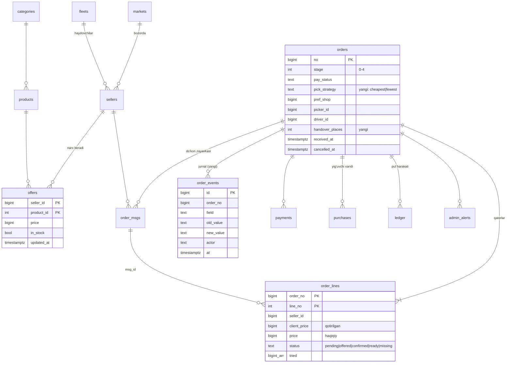

# Ta'mir — loyiha dizayni (buyurtma oqimi asosida)

Manba: «Ta'mir — буюртма оқими архитектураси» (PDF, 2026-10-30) va repolarning hozirgi holati
(`Tamir-Test` main = migratsiya 15, `Tamir-Bot` main = PR #11).

Bu hujjat **reja**. Kod va baza hali o'zgartirilmagan. Har bir o'zgarish alohida PR, `.down.sql` bilan,
avval TEST'da, tasdiqingizdan keyin.

---

## 1. Qisqacha xulosa

- PDF'dagi oqim (bozor → narx → to'lov → do'kon zayavkasi → yig'ish → park → yetkazish → yopish) **hozirgi kodda
  ~70% bor**. Asosiy jadvallar (`orders`, `order_lines`, `offers`, `order_msgs`, `ledger`, `purchases`,
  `admin_alerts`) PDF'dagi model bilan mos keladi. Qayta yozish kerak emas, qo'shimcha (additive) qadamlar yetadi.
- Arxitektura: **Supabase modulli monoliti** (bitta Postgres + RPC + bitta Edge Function + pg_cron) saqlanadi.
  Mikroservislar hozir kerak emas (ADR-001).
- Eng katta 3 bo'shliq: (1) holatlar jurnali «kim o'tkazdi» bilan yo'q, (2) mijozning «Eng arzon / Kamroq do'kon»
  tanlovi yo'q, (3) Click/Payme va yopilgandan keyingi hisob-kitob avtomatik emas.
- Hujjat bilan kod orasida 4 ta nomuvofiqlik bor (3-bo'lim), ularni hal qilish kerak.
- **Qabul qilingan qarorlar (2026-10-30):** narxni do'konchi kiritadi; do'kon tovarni tayyorlaydi, yig'uvchi
  tayyor tovarni do'konlardan olib ketadi; do'kon javob bermasa zayavka avtomatik keyingi do'konga o'tadi
  (8-bo'lim, ADR-010).

---

## 2. Hozirgi holat (as-is) va PDF bilan solishtirish

### 2.1 Ilovalar

| Rol | PDF | Repoda | Kirish |
|---|---|---|---|
| Mijoz | `index.html` | `index.html` | Telegram + telefon |
| Do'kon | `shop.html` + bot | **`seller.html`** + bot | Telegram |
| Yig'uvchi | `collector.html` | `collector.html` | `clogin` → `collector_sessions` → `x-col-session` |
| Haydovchi | `driver.html` | `driver.html` | `driver_login` → `driver_sessions` |
| Admin | `admin.html` | `admin.html` | Telegram + shaxsiy PIN/kod |
| Bot | Edge Function `tg-bot` | `Tamir-Bot/supabase/functions/tg-bot/index.ts` (1835 qator) | — |

### 2.2 Buyurtma holatlari: PDF'dagi 8 holat ↔ bazadagi `orders.stage` (0–4)

Bazada holat bitta `stage` raqami + bir nechta ustunlardan kelib chiqadi. PDF'dagi 8 holatni ustunlarni
o'zgartirmasdan **hisoblab** olish mumkin:

| # | PDF holati | Bazadagi shart (hozirgi kod bo'yicha) |
|---|---|---|
| 1 | Yangi (to'lov kutilmoqda) | `stage = 0 and pay_status not in ('paid')` |
| 2 | To'landi | `stage = 0 and pay_status = 'paid'` |
| 3 | Yig'uvchi oldi / do'konlarga zayavka | `stage = 1 and picked = 0` |
| 4 | Yig'ilmoqda | `stage = 1 and picked > 0` |
| 5 | Parkka berildi | `stage = 2` |
| 6 | Yo'lda | `stage = 3` |
| 7 | Yetkazildi | `stage = 4 and received_at is null` |
| 8 | Yopildi | `stage = 4 and received_at is not null` |
| — | Bekor qilingan | `cancelled_at is not null` (migratsiya 08) |

`sellers` rejimida 3-holat «hamma qatorlar do'konlarga taqsimlandi» degani (`checkAllocated` → `stage 1`),
2-holat esa do'kon «Tayyor» bosganda (`shopReadyCore` → `stage 2`). Bu jadvalni birinchi PR'da
TEST bazadagi haqiqiy buyurtmalar bilan tekshiraman.

### 2.3 PDF'dagi «Hozir / Kerak» jadvali kodga nisbatan

| Qism | PDF | Kodda aslida |
|---|---|---|
| Do'konga zayavka, «Tayyor» | Qisman | `sellers` rejimida bor: `route()` qatorlarni do'konlarga bo'ladi, `order_msgs` (confirmed/ready/expired), `shopReadyCore`, `shopLoadedCore` |
| Arzon / Kamroq do'kon | Ishlamaydi | `route()` allaqachon «arzon + kam do'kon» gibridi (`PRICE_TOL = 3%`). Mijozga tanlov yo'q. `cart_compare` (mig. 11/14/15) va `pref_shop` (mig. 12) bor |
| Avtomatik qayta taqsimlash | Faqat ogohlantirish | `sellers` rejimida `ANSWER_MIN` (5 daq) o'tsa **avtomatik keyingi do'konga o'tadi** (`tried[]`). Yig'uvchi rejimida faqat ogohlantirish |
| Click/Payme | Hali yo'q | `payments` (unique `provider, provider_trans_id`), `payment_providers`, `refunds` jadvallari tayyor, webhook yo'q |
| Hisob-kitob | — | `ledger` (kind: customer_payment, shop_goods, driver_pay, collector_pay, gateway_fee, platform_income, refund, reserve_hold), `purchases`, `staff_payouts` bor |

---

## 3. Nomuvofiqliklar (hal qilish kerak)

1. **`shop.html` vs `seller.html`.** PDF `shop.html`, `slogin`, `x-shop-session`, «SQL 30/31, bot v72/v73» deydi.
   Repoda bular yo'q: migratsiyalar 15 da tugaydi, bot `main` PR #11. Ehtimol bu o'zgarishlar Supabase'ga
   qo'lda qo'yilgan, lekin repoga tushmagan. **Xavf:** PROD'ni migratsiyalardan qurganda ular yo'qoladi.
2. **Yig'uvchi bormi?** PDF 5 rolni (yig'uvchi bilan) asosiy model deydi. `plans/shop-fulfillment-plan.md`
   esa «yig'uvchini olib tashlash, do'kon o'zi yig'adi» degan. Ikkalasi kodda `app_settings.mode`
   (`pickers` / `sellers`) bilan yashaydi. **Hal qilindi:** ikkalasining qo'shilmasi — do'kon tayyorlaydi,
   yig'uvchi olib ketadi (ADR-010).
3. **Avtomatik qayta taqsimlash** PDF'da «yo'q» deyilgan, lekin `sellers` rejimida bor (yuqorida).
4. **Narx zaxirasi.** PDF 5% deydi, kodda `PRICE_TOL = 3%` (taqsimlash uchun) va `orders.reserve_sum`
   (to'lov zaxirasi) alohida. Ikkalasini `app_settings` ga chiqarish va hujjatda bitta raqam qilish kerak.

---

## 4. Arxitektura qarorlari (ADR)

Har ADR: kontekst → variantlar → qaror → oqibat.

### ADR-001. Supabase modulli monoliti saqlanadi

- **Kontekst:** bitta dasturchi, byudjet ~0, muddat 2 oy, ishlayotgan kod va API buzilmasligi kerak.
- **Variantlar:**
  - A) Hozirgidek: Postgres + `security definer` RPC + bitta `tg-bot` Edge Function + pg_cron. Arzon, tez, bitta joyda.
  - B) Alohida backend (NestJS/Go) + Postgres. To'liq nazorat, lekin hamma API qayta yoziladi, server kerak.
  - C) Mikroservislar (order, payment, catalog). 1 mln foydalanuvchida foydali, hozir faqat murakkablik.
- **Qaror:** A. Ichida modullarni aniq ajratamiz (5-bo'lim): har modul o'z jadvallari va RPC'lari, boshqa modul
  jadvaliga faqat RPC orqali yozadi.
- **Oqibat:** `tg-bot` 1835 qatorli bitta faylda. Keyingi qadam: uni bitta funksiya qoldirib, modullarga
  bo'lish (`orders.ts`, `shops.ts`, `drivers.ts`, `pay.ts`). To'lov webhook'i alohida Edge Function bo'ladi
  (ADR-007), chunki uning xavfsizlik chegarasi boshqa.

### ADR-002. Holat mashinasi: `stage` saqlanadi, ustiga nomli holat va jurnal

- **Kontekst:** PDF «har o'tish jurnalga vaqt va kim o'tkazgani bilan» deydi. Hozir `orders.times` faqat
  vaqtlar massivi, kim o'tkazgani yo'q. `stage` raqamiga sayt, bot va admin bog'langan.
- **Variantlar:**
  - A) `stage` ni `status text` enum'ga almashtirish. Toza, lekin barcha API buziladi.
  - B) `stage` qoladi; yangi `order_events` jadvali + `orders` dagi o'zgarishni yozuvchi trigger +
    `order_status(orders)` funksiyasi (2.2 jadvali). Hech narsa buzilmaydi.
- **Qaror:** B.
- **Tafsilot:** trigger `stage`, `pay_status`, `picker_id`, `driver_id`, `received_at`, `cancelled_at`
  o'zgarishini yozadi. «Kim» — RPC/bot so'rov boshida `set_config('tamir.actor', 'driver:12', true)`
  qo'yadi, trigger `current_setting('tamir.actor', true)` ni o'qiydi; bo'lmasa `'system'`.
  `order_events` ga `update/delete` huquqi berilmaydi (faqat qo'shiladi).

### ADR-003. Narx qatlami: mavjud `offers` jadvali

- **Kontekst:** PDF «tovar × do'kon → narx, mavjudmi, yangilangan vaqt». `offers (seller_id, product_id) PK,
  price, in_stock, updated_at` aynan shu. `price_history` ham bor.
- **Qaror:** yangi jadval yo'q. Qo'shiladi: `offers_market` view (offer + do'kon bozori + `stale = updated_at <
  now() - 3 kun`), sayt «taxminiy» belgisini shundan oladi. Muddat `app_settings.price_stale_days`.
- **Narxni do'konchi kiritadi** (qaror, 8-bo'lim): `seller.html` (qo'lda va Excel/CSV). Admin faqat
  boshlang'ich to'ldirish va tekshirish uchun. Bot har 3 kunda yangilanmagan narxlar haqida do'konga eslatadi.

### ADR-004. «Eng arzon» va «Kamroq do'kon» bitta SQL funksiyada

- **Kontekst:** `route()` (bot) qatorlarni do'konlarga taqsimlaydi; sayt `cart_compare` bilan alohida
  hisoblaydi. Ikki joyda ikki xil hisob = mijoz ko'rgan narx bilan haqiqiy taqsimot farq qilishi mumkin.
- **Variantlar:**
  - A) Saytda JS'da hisoblash. Tez, lekin mijozga ishonib bo'lmaydi va bot bilan farq qiladi.
  - B) Botda qoldirish, saytga natijani API orqali berish. Bot sekin, saytdan har bosishda Edge Function.
  - C) `cart_plan(p_market, p_items, p_strategy)` SQL funksiyasi; sayt (oldindan ko'rish) ham, `route()` ham
    shuni chaqiradi.
- **Qaror:** C. Ikki usul bitta parametr bilan farq qiladi — narx bardoshliligi:
  `cheapest` → bardosh 0% (har qator eng arzon do'kondan), `fewest` → bardosh `app_settings.fewest_tol_pct`
  (masalan 5%: do'kon eng arzondan 5% gacha qimmat bo'lsa ham, ko'proq qatorni bitta do'konda yig'ish).
  Bu hozirgi `route()` algoritmining o'zi, faqat SQL'ga ko'chiriladi va parametrlanadi.
- **Baza:** `orders.pick_strategy text default 'fewest'` (hozirgi xatti-harakat saqlanadi).
  `client_price` buyurtma vaqtida qotiriladi (hozir ham shunday).

### ADR-005. Do'konga zayavka: `order_msgs` = do'kon-buyurtma bog'lanishi

- **Kontekst:** PDF «buyurtma do'konlar bo'yicha bo'linadi». Avvalgi reja `order_shops` jadvalini taklif qilgan
  edi; `order_msgs (order_no, seller_id, confirmed_at, ready_at, expired_at)` aynan shu vazifani bajaradi.
- **Qaror:** yangi jadval yo'q, `order_msgs` shu rolni oladi. Maxfiylik: do'kon xabarida faqat tovar, miqdor,
  narx, vaqt (hozirgi `offerText` mijoz ismi/telefonini yubormaydi — saqlanadi, testga qo'shiladi).
- **Javob bermasa (qaror):** 5 daqiqada javob bo'lmasa yoki «Yo'q» desa, qator avtomatik keyingi arzon
  do'konga o'tadi (`tried[]`, hozirgi `sellers` mantiqi) va adminga xabar boradi. Narx farqi zaxiradan
  oshsa — mijozdan so'raladi. Muddat `app_settings.answer_minutes`.

### ADR-006. Taymerlar: bitta `watchdog()` + pg_cron

- **Kontekst:** PDF'da 5 ta muddat: 30 daq to'lanmasa bekor, 5 daq do'kon/yig'uvchi javob bermasa, 10 daq
  haydovchi olmasa, 24 soat «Oldim» bosilmasa avtomatik yopish. Hozir qisman botda, qisman pg_cron'da
  (migratsiya 09 skaneri).
- **Qaror:** bitta `public.watchdog()` SQL funksiyasi har daqiqada; har ogohlantirish `admin_alerts.key`
  bo'yicha bir marta (idempotent). Bot xabarlarni `admin_alerts` dan o'qib yuboradi. Muddatlar `app_settings`
  da. Avto-yopish `order_events` ga `actor = 'auto'` bilan yoziladi.

### ADR-007. To'lov: Click/Payme alohida Edge Function `pay`

- **Qaror:** to'lov webhook'lari `tg-bot` ga emas, alohida `pay` funksiyaga keladi: imzo/login tekshiruvi,
  `payments (provider, provider_trans_id)` unique orqali idempotentlik, summa `orders.pay_amount` bilan solishtirish.
  Karta ma'lumoti hech qachon bizga kelmaydi (Click/Payme o'z sahifasida) — shu sababli PCI DSS doirasi
  SAQ A darajasida qoladi.
- **Muhim:** hozir yig'uvchiga chiqish sharti `pay_status in ('paid','none')`. `'none'` = naqd/to'lovsiz
  rejim. To'lov ulangandan keyin `'none'` faqat admin ruxsati bilan qolishi kerak, aks holda to'lanmagan
  buyurtma yig'uvchiga chiqadi.

### ADR-008. Hisob-kitob: `ledger` faqat qo'shiladi

- **Qaror:** yopilganda (`received_at` yoki avto-yopish) bitta `settle_order(no)` funksiyasi `ledger` ga
  yozadi: `shop_goods` (har do'konga tovar summasi − komissiya `coalesce(sellers.commission_pct,
  seller_commission_pct)`), `collector_pay`, `driver_pay`, `gateway_fee`, `platform_income`.
  Ikki marta yozilmasligi uchun `(order_no, kind, …)` bo'yicha tekshiruv. Tuzatish faqat teskari yozuv
  (`reverses`), o'chirish yo'q — `ledger` ga `update/delete` huquqi berilmaydi.

### ADR-009. Kirish: bitta sxema, qisqaroq sessiya

- **Kontekst:** `*_login` (30 daq token) → bot Start → `*_sessions` → sarlavha. Haydovchi/do'kon 365 kun.
- **Qaror:** sxema saqlanadi. Tavsiya: 365 kun → 30 kun «sirpanuvchi» (har kirishda uzayadi), bloklanganda
  sessiyalar darhol o'chadi. Bu xavfsizlik o'zgarishi, alohida tasdiq bilan.

### ADR-010. Bajarish modeli: do'kon tayyorlaydi, yig'uvchi olib ketadi

- **Kontekst:** hozir ikki rejim bor. `pickers`: yig'uvchi buyurtmani oladi va do'konlardan o'zi **sotib oladi**
  (`purchases`). `sellers`: do'konlar ✅/❌ va «Tayyor» qiladi, **haydovchi** do'konlardan yig'adi.
  Qaror: do'kon tayyorlaydi (sellers'dagi kabi), lekin do'kondan **yig'uvchi** olib ketadi.
- **Variantlar:**
  - A) Yangi `mode = 'shop_collect'` qiymati: `sellers` taqsimoti + yig'uvchi bosqichi. Eski ikki rejim
    o'zgarmaydi, TEST'da sozlama bilan yoqiladi/qaytariladi.
  - B) `sellers` rejimini o'zgartirish (haydovchi o'rniga yig'uvchi). Kamroq kod, lekin ishlayotgan
    rejim buziladi va qaytarish qiyin.
- **Qaror:** A.
- **Oqim (`shop_collect`):**
  1. To'lovdan keyin `route()` qatorlarni do'konlarga bo'ladi (`order_msgs`), do'kon ✅/❌ → «Tayyor».
  2. Hamma qatorlar taqsimlangach (`stage 1`), buyurtma bozordagi yig'uvchilarga chiqadi (`offerToPickers`),
     birinchi bosgan oladi (`claimOrder`).
  3. `collector.html`: ro'yxat do'kon bo'yicha, har do'kon yonida «Tayyor / tayyorlanmoqda». Yig'uvchi
     faqat «Tayyor» do'konga boradi, qatorni «olindi / yetmadi» qiladi. Yig'uvchi **sotib olmaydi**, pul
     bermaydi (`purchases` yozilmaydi).
  4. Hamma qator belgilansa — «Parkka berildi» (`stage 2`), joy/qator sanog'i bilan.
- **Do'konga pul:** yopilgandan keyin `settle_order()` orqali (ADR-008), komissiya chegirilib.
  Bu do'kon uchun yangi shart (hozir `sellers` rejimida haydovchi to'lov so'raydi) — 8-bo'lim, 4-savol.

---

## 5. Modullar (monolit ichida)

| Modul | Jadvallar | Kim yozadi | Ilova |
|---|---|---|---|
| Katalog va narx | `categories`, `products`, `offers`, `price_history`, `markets` | do'kon (seller.html), admin | index, seller, admin |
| Savat va taklif | — (`cart_plan`, `quote_order`, `cart_compare`) | — | index |
| Buyurtma | `orders`, `order_lines`, `order_events`*, `order_msgs` | RPC, bot | hammasi |
| Do'kon zayavkasi | `order_msgs`, `order_lines.status` | bot (`route`), do'kon | bot, seller |
| Yig'ish (olib ketish) | `orders.picker_*`, `order_lines.status`, `collector_*` | yig'uvchi | collector |
| Yetkazish | `orders.driver_*`, `fleets`, `delivery_tariffs`, `driver_*` | haydovchi | driver |
| To'lov | `payments`, `payment_providers`, `refunds` | `pay` Edge Function* | index |
| Hisob-kitob | `ledger`, `staff_payouts`, `fee_settings` | `settle_order`* | admin |
| Nazorat | `admin_alerts`, `audit_log`, `events` | `watchdog`* | admin, bot |
| Kirish | `admin_*`, `login_tokens`, `*_login`, `*_sessions`, `profiles` | RPC | hammasi |

`*` = yangi.

---

## 6. Ma'lumotlar modeli (ERD, faqat asosiy jadvallar)

### Qo'shimcha o'zgarishlar (hammasi additive, `.down.sql` bilan)

| Migratsiya | O'zgarish |
|---|---|
| 16 `order_events` | jadval + trigger + `order_status()` + RLS (faqat admin o'qiydi) |
| 17 `watchdog` | `watchdog()` funksiyasi, `app_settings` muddatlari, pg_cron vazifasi |
| 18 `cart_plan` | `cart_plan()`, `orders.pick_strategy`, `offers_market` view |
| 19 `handover` | `orders.handover_places`, `orders.handover_lines`, yig'ish ro'yxati do'kon bo'yicha (`collector_list()`) |
| 20 `settle` | `settle_order()`, `ledger` himoyasi (update/delete huquqi yo'q) |
| 21 `pay` | `payment_providers` sozlamalari, `pay_status` o'tishlari |

Raqamlar taxminiy: avval 3-bo'limdagi «SQL 30/31» masalasini hal qilamiz.

---

## 7. Bosqichma-bosqich reja (PDF 10-bo'limi asosida)

Har qadam = 1 PR (sayt va/yoki bot), avval TEST, keyin keyingisi.

### 0-bosqich. Tozalash (1–2 kun)
- Supabase TEST'dagi qo'lda qo'yilgan o'zgarishlarni (SQL 30/31, bot v72/v73, `shop.html`) repoga tushirish.
  `supabase/audit/02_export_schema.sql` natijasini migratsiyalar bilan solishtirish.
- Kerakli materiallar: (a) TEST SQL Editor'da `02_export_schema.sql` natijasi (JSON/jadval), (b) Supabase →
  Edge Functions → `tg-bot` → Code dagi joriy kod (v73), (c) `shop.html` fayli (agar saytda bo'lsa).
- **DoD:** TEST bazasi = baseline + migratsiyalar; `tg-bot` repodagi kod = deploy qilingan kod.

### 1-bosqich. Bozor, narx qatlami, do'konga zayavka (≈1 hafta)
- Migratsiya 16 (`order_events`) va 17 (`watchdog`).
- `offers_market` + «taxminiy narx» belgisi saytda.
- `shop_collect` rejimi (ADR-010): bot + `collector.html` (do'kon bo'yicha ro'yxat, «Tayyor» belgisi).
- **DoD:** har bir holat o'tishi `order_events` da kim bilan; 5/10/30 daqiqa va 24 soat taymerlari TEST'da
  sun'iy vaqt bilan tekshirilgan; do'kon xabarida mijoz ma'lumoti yo'qligi testda.

### 2-bosqich. Mijoz tanlovi (≈1 hafta)
- Migratsiya 18 `cart_plan()`; savatda «Eng arzon» / «Kamroq do'kon» tugmalari; `route()` `cart_plan` ni chaqiradi.
- **DoD:** bir xil savat uchun sayt ko'rsatgan do'konlar = bot taqsimlagan do'konlar (SQL test,
  `supabase/tests/`); `client_price` qotiriladi; 5% zaxira to'lov sahifasida ko'rinadi.

### 3-bosqich. Yig'ish va park (≈1 hafta)
- `collector.html`: ro'yxat do'konlar bo'yicha guruhlangan; qator: olindi / yetmadi / almashtirildi.
- Parkka topshirish: «nechta joy, nechta qator» sanash (migratsiya 19).
- **DoD:** yig'uvchi bir do'konga bir marta boradi; topshirish soni `order_events` da.

### 4-bosqich. To'lov va komissiya (≈2 hafta)
- `pay` Edge Function (avval Click yoki Payme — bittasi), sandbox'da test.
- `settle_order()` yopilganda; admin'da «To'lanishi kerak» ro'yxati.
- **DoD:** takroriy webhook ikki marta pul yozmaydi; noto'g'ri imzo rad etiladi; `ledger` yig'indisi =
  mijoz to'lovi.

### 5-bosqich. PROD (bir marta)
- PROD bazasini baseline + migratsiyalardan noldan qurish, katalog seed, bot PROD tokeni, tungi bekap.
- **DoD:** TEST'da to'liq oqim (bozor → yopish → hisob) 3 marta xatosiz; bekapdan tiklash bir marta sinalgan.

---

## 8. Qarorlar va qolgan savol

| # | Savol | Qaror (2026-10-30) |
|---|---|---|
| 1 | Real narxlarni kim kiritadi? | Do'konchi (ADR-003) |
| 2 | Yig'ish kim tomonidan? | Do'kon tayyorlaydi, yig'uvchi olib ketadi (ADR-010) |
| 3 | Do'kon javob bermasa? | Avtomatik keyingi do'konga + adminga xabar (ADR-005) |

**4. Ochiq: do'konga pul qachon va kim to'laydi?**
- A) Yopilgandan keyin platforma to'laydi (komissiya chegirilib). Yig'uvchi naqd pul tashimaydi, nazorat oson.
  Kamchiligi: do'kon 1–2 kun kutadi, ishonch kerak. **Tavsiya.**
- B) Yig'uvchi olib ketayotganda to'laydi (hozirgi `pickers` kabi). Do'kon uchun qulay, lekin yig'uvchida
  katta naqd/karta oqimi va xatolik xavfi.

---

## 9. Xavflar (top-5)

| # | Xavf | Ta'sir | Choralar |
|---|---|---|---|
| 1 | TEST'dagi qo'lda o'zgarishlar repoda yo'q | PROD'da funksiyalar yo'qoladi | 0-bosqich |
| 2 | `tg-bot` uchun avtomatik test yo'q, 1835 qator bitta faylda | har o'zgarish oqimni buzishi mumkin | modullarga bo'lish, `route`/`cart_plan` SQL'ga ko'chib SQL testlar bilan |
| 3 | `pay_status = 'none'` to'lovsiz buyurtmani o'tkazadi | to'lanmagan buyurtma bajariladi | ADR-007 |
| 4 | 365 kunlik sessiyalar | o'g'irlangan telefon = 1 yillik kirish | ADR-009 |
| 5 | Bekap kunda 1 marta (RPO 24 soat) | 1 kunlik buyurtma yo'qolishi | PROD'da Supabase PITR (pullik) yoki bekapni har soatda; RTO maqsadi 4 soat |

---

## 10. Tasdiq kerak bo'lgan o'zgarishlar ro'yxati

Hech biri hali qilinmagan. Tasdiqlasangiz, 0-bosqichdan boshlayman:

- [ ] 0-bosqich: TEST'dagi qo'lda o'zgarishlarni repoga tushirish (sizdan: SQL 30/31 va bot v72/v73 fayllari
      yoki TEST bazadan `02_export_schema.sql` natijasi).
- [ ] Migratsiya 16 `order_events` (faqat qo'shiladi, mavjud API o'zgarmaydi).
- [ ] Migratsiya 17 `watchdog` (bot ichidagi taymerlar bilan birga o'zgaradi).
- [ ] `cart_plan` va `pick_strategy` (sayt + bot).
- [ ] Sessiya muddatini 365 → 30 kun (xavfsizlik, alohida qaror).
